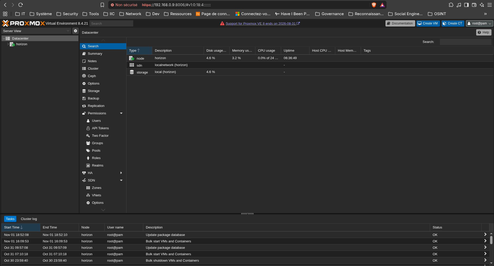

# 1. Spécifications machine

- **CPU** : Intel core i9 12900k
- **RAM** : 64Go DDR5
- **Stockage** : SSD Samsung 1To (système, VM, ISO)
- **GPU** : Nvidia RTX 3080 (passthrough prévu)

# 2. Système

L'hyperviseur sera installé par dessus Debian bookworm

# 3. Installation

## 3.1 modification du fichier hosts

En étant connecté en ssh ou directement sur le terminal de l'hôte
```
nano /etc/hosts
```

on y modifie la seconde ligne afin d'avoir son ip sur le réseau local suivi de son hostname :
```
127.0.0.1       localhost
192.168.0.9   horizon.homelab horizon

# The following lines are desirable for IPv6 capable hosts
::1     localhost ip6-localhost ip6-loopback
ff02::1 ip6-allnodes
ff02::2 ip6-allrouters
```

Vérification de la manipulation : 
```
hostname --ip-address
```
doit retourner les données configurées dans le fichier

## 3.2 Installation de Proxmox

### Adaptation du sources.list

Dans un terminal (en ssh): 
```
echo "deb [arch=amd64] [http://download.proxmox.com/debian/pve](http://download.proxmox.com/debian/pve) bookworm pve-no-subscription" > /etc/apt/sources.list.d/pve-install-repo.list
```

On ajoute la clé du déôt de Proxmox VE
```
wget [https://enterprise.proxmox.com/debian/proxmox-release-bookworm.gpg](https://enterprise.proxmox.com/debian/proxmox-release-bookworm.gpg) -O /etc/apt/trusted.gpg.d/proxmox-release-bookworm.gpg 
# verify
sha512sum /etc/apt/trusted.gpg.d/proxmox-release-bookworm.gpg 
7da6fe34168adc6e479327ba517796d4702fa2f8b4f0a9833f5ea6e6b48f6507a6da403a274fe201595edc86a84463d50383d07f64bdde2e3658108db7d6dc87 /etc/apt/trusted.gpg.d/proxmox-release-bookworm.gpg
```

Et on met à jour le dépôt et le système :
```
apt update && apt full-upgrade
```

### Installation du noyau Proxmox VE

```
apt install proxmox-default-kernel

systemctl reboot
```

### Installation des paquets Proxmox

```
apt install proxmox-ve postfix open-iscsi chrony
```

### Retrait du noyau Debian

```
apt remove linux-image-amd64 'linux-image-6.1*'

update-grub
```

## 3.3 Connection à l'interface web

```
Se connecter à l'adresse https://votre-adresse-ip:8006
```



