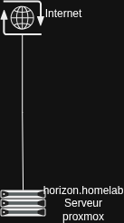

# ⚡ Homelab Infrastructure & Lab Environment

> Infrastructure de virtualisation sous Proxmox VE, dédiée à l'apprentissage de l'administration système, du routage réseau (préparation CCNA) et à la mise en place d'une maquette d'entreprise hétérogène.

---

## 🏗️ Architecture Hôte (Phase 0)

L'infrastructure repose sur un hyperviseur **Proxmox VE** installé sur une machine dédiée (ancien PC Gaming). 

* **Hyperviseur :** Proxmox VE (dépôts *No-Subscription* activés).
* **Réseau Hôte :** Bridge virtuel privé (`vmbr1`) relié à l'interface Wi-Fi physique via **NAT / Masquerade** (`iptables`).
* **Services Hôte :** **DNSmasq** sur l'hôte pour la résolution DNS locale et le serveur DHCP du réseau NAT.
* **Virtualisation Imbriquée :** Support *Nested Virtualization (VT-x/AMD-V)* activé pour les laboratoires virtuels.

---

## 🗺️ Feuilles de Route des Phases

```text
02_Homelab/
├── README.md                          # Vue d'ensemble du Homelab (ce fichier)
├── assets/                            # Captures d'écran et schémas d'architecture
├── phase-0-infrastructure-base/       # Socle Proxmox, stockage et réseau NAT/DNSmasq
└── phase-1-workloads-et-vms/          # Modèles de VM, postes clients et labs réseau
````

### 🟢 Phase 0 — Socle & Infrastructure de Base (Terminé)

- [x] Installation de Proxmox VE et configuration des pools de stockage.
    
- [x] Suppression des dépôts Enterprise et passage au canal _No-Subscription_.
    
- [x] Configuration du bridge virtuel NAT et du forwarding IP sur l'interface Wi-Fi hôte.
    
- [x] Déploiement et configuration de `dnsmasq` sur l'hôte Proxmox.




### 🟡 Phase 1 — Workloads, Poste Client & Lab CCNA (En cours)

- [ ] **Template Windows 10 :** Installation ISO sans clé, intégration des pilotes VirtIO/QEMU Agent, conversion en Template master.
    
- [ ] **Workstation Linux :** Déploiement d'un client Ubuntu Desktop connecté au bridge NAT.
    
- [ ] **Réseau Flat & pfSense :** Maintien d'un réseau plat partagé (2 semaines) avant l'isolement par router/firewall pfSense.

- [ ] **Lab Réseau CCNA (EVE-NG) :** Déploiement d'EVE-NG Community sur Proxmox avec processeur hôte (_Nested VT-x_) pour le maquetage des topologies Cisco.

## 📊 Matrice des Workloads & Services

| **Service / VM**   | **Type**    | **Réseau**     | **Rôle / Description**               | **Statut**  |
| ------------------ | ----------- | -------------- | ------------------------------------ | ----------- |
| **Proxmox Host**   | Hyperviseur | Physique / NAT | Hôte principal + DNSmasq / NAT       | 🟡 En cours |
| **Win10-Template** | Template VM | `vmbr0` (NAT)  | Image master Windows 10 (VirtIO)     | ⚪ Planifié  |
| **Ubuntu-Desktop** | VM Client   | `vmbr0` (NAT)  | Station de travail Linux utilisateur | ⚪ Planifié  |
| **EVE-NG Server**  | VM Nested   | `vmbr0` (NAT)  | Plateforme d'émulation réseau (CCNA) | ⚪ Planifié  |
| **pfSense**        | Router / FW | Multi-Bridges  | Routage central et filtrage          | ⚪ Planifié  |
